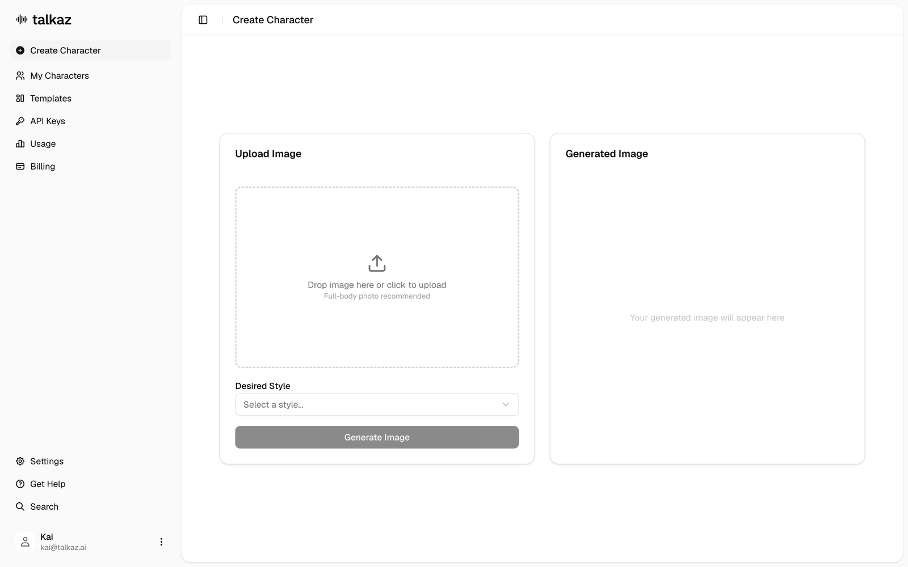
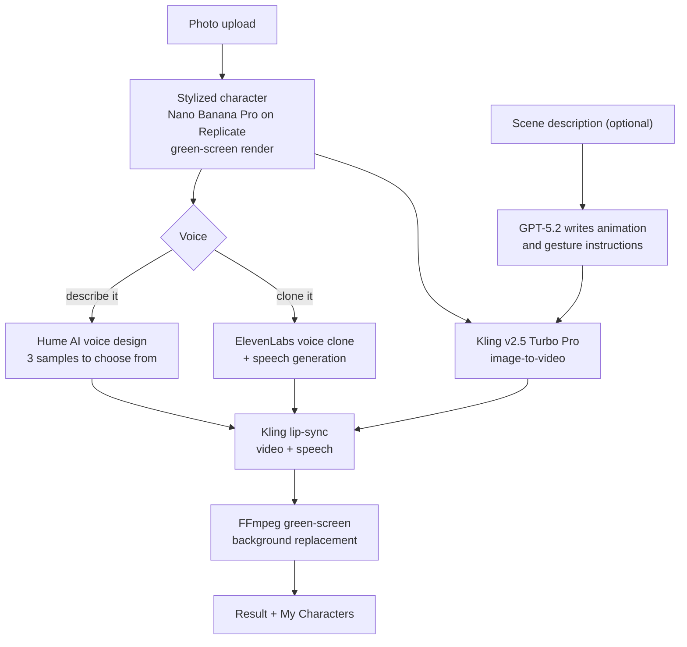
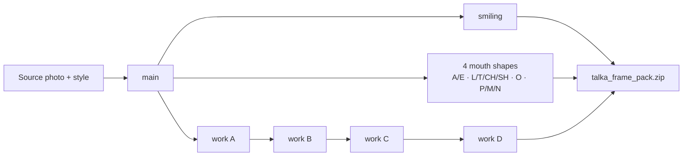

<p align="center">
  <picture>
    <source media="(prefers-color-scheme: dark)" srcset="docs/logo-dark.png">
    
  </picture>
</p>

<p align="center"><strong>Turn a photo into a talking character video.</strong><br>
Stylize yourself, give the character a voice and get a lip-synced clip.</p>

<p align="center">
  
  
  
  
  
  
</p>

<p align="center">
  Frame packs feed <a href="https://github.com/kpr17ch/talka">talka</a> and <a href="https://github.com/kpr17ch/talka-ios">talka-ios</a>
</p>

---

talkaz chains several generative models into one guided flow. Upload a full-body photo and pick a style (PlayStation 2, Anime, Cartoon). The backend renders a stylized character on a green screen with Nano Banana Pro. You then give it a voice: designed from a text description with Hume AI or cloned from your own sample with ElevenLabs. Kling animates the character from your spoken line and an optional scene description, which GPT-5.2 turns into animation and gesture instructions. A Kling lip-sync pass merges in the speech, and FFmpeg replaces the green screen with a background. The project started at a two-day AI hackathon. It was later extended with a **character-set pipeline** that generates the 10-frame animation pack used by the [talka](https://github.com/kpr17ch/talka) voice clients.

<p align="center">
  
</p>

## How it works



### Character-set pipeline (frame pack for talka)

`POST /api/v1/character-set/generate` starts a background job that renders ten frames in a fixed order. Each frame uses the main render or the previous work frame as its reference, which keeps identity, framing and the green screen constant. The frames are normalized to 2048×2048 JPEG and zipped as a frame pack that the talka clients load directly.



The prompt spec for every frame is documented in [`docs/character-pipeline/`](docs/character-pipeline/).

## Features

- Four-step wizard: image → voice → video → background, with progress polling for long-running predictions.
- Three style presets for the character render, plus a green-screen output that is ready for compositing.
- Two voice paths: Hume AI voice design from a description (three candidates) or ElevenLabs instant voice cloning.
- LLM-assisted video prompting: GPT-5.2 converts a free-text scene ("birthday video for my brother") into animation and gesture sections for Kling.
- Lip-sync and background replacement as separate, re-runnable steps.
- "My Characters" gallery stored in the browser.
- Character-set job API with status, per-frame URLs and ZIP download.
- FastAPI with interactive docs at `/docs`.

## Tech stack

| Area | Technology |
| --- | --- |
| Frontend | Next.js 16, React 19, TypeScript, Tailwind CSS 4, shadcn/ui |
| Backend | Python, FastAPI, Pydantic Settings, httpx, Pillow |
| Image | `google/nano-banana-pro` via Replicate |
| Video | `kwaivgi/kling-v2.5-turbo-pro`, `kwaivgi/kling-lip-sync` via Replicate |
| Voice | Hume AI (voice design), ElevenLabs (`eleven_multilingual_v2`, voice cloning) |
| Prompting | OpenAI `gpt-5.2` (Responses API) |
| Media | FFmpeg (trim, merge, chroma-key background) |

## Quick start

Requires Node.js 20+, Python 3.11+, FFmpeg on `PATH`, and API keys for Replicate, Hume AI, ElevenLabs and OpenAI.

```bash
git clone https://github.com/kpr17ch/talkaz.git
cd talkaz
# create backend/.env with the keys listed below
npm run start
```

`npm run start` installs root and frontend dependencies, creates `backend/venv`, installs the Python requirements and starts both services:

- Frontend: http://localhost:3000
- Backend: http://localhost:8000 (API docs at http://localhost:8000/docs)

Run them separately with `npm run dev:frontend` and `npm run dev:backend`.

## Environment variables

| Variable | Where | Purpose |
| --- | --- | --- |
| `REPLICATE_API_TOKEN` | `backend/.env` | Image, video and lip-sync models |
| `HUME_API_KEY` | `backend/.env` | Voice design |
| `ELEVENLABS_API_KEY` | `backend/.env` | Voice cloning and speech |
| `OPENAI_API_KEY` | `backend/.env` | Scene-to-prompt generation |
| `UPLOAD_DIR` | `backend/.env` | Local media directory (default `uploads`) |
| `NEXT_PUBLIC_API_URL` | `frontend/.env.local` | Backend URL (default `http://localhost:8000`) |

## Project structure

```text
backend/
  app/api/v1/          # image, voice, video, character-set routes
  app/services/        # replicate, hume, elevenlabs, openai, ffmpeg, character_set
  app/models/          # request/response schemas
frontend/
  app/                 # create-character and my-characters pages
  components/create-character/   # wizard steps
  lib/api.ts           # backend client
docs/character-pipeline/         # frame-by-frame prompt specification
```

## Status

Hackathon prototype (January–March 2026), local development only.

- No user accounts or persistence beyond local files and browser storage. Sidebar items such as Templates, API Keys, Usage and Billing are placeholder navigation.
- Character-set jobs are tracked in memory and run inside the API process.
- The character-set pipeline is available through the API only and is not yet part of the wizard.
- Debug logging in some services writes to `.cursor/debug.log` and should be removed or put behind a flag.

## Team

Built at a two-day AI hackathon by a team of two, including [Kai Perich](https://github.com/kpr17ch).
